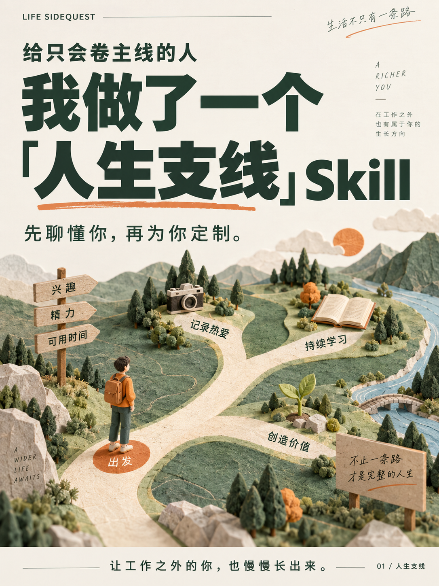

# 给只会卷主线的人，我做了一个「人生支线」Skill

**Life SideQuest：先聊懂你，再为你生成专属人生支线。**

[开始使用](docs/installation.md) · [看完整生成示例](examples/generated/sidequest-slow-living/SKILL.md) · [定时与邮件](docs/automation.md) · [宣传配图](docs/visuals.md) · [参与改进](CONTRIBUTING.md)



*AI 生成宣传示意，不是独立 App 的实际界面。*

**你的人生，不该只有一条正在赶进度的主线。**

工作、论文、考试、项目……每天都很满。
可你也想拍出好看的照片，聊聊工作以外的话题，弄懂一些以前绕着走的事，或者只是认真培养一个爱好。

不是为了再卷一项技能。是想让生活里，多一点「这是我自己想做的」。

但一打开收藏夹，又是教程、清单、几十种不知道该用哪个的 Skill。

**你缺的可能不是下一个万能 Skill，而是一个先认识你、再为你量身定做的 Skill。**

先聊懂你，再定制；每次一小步，按你的反馈继续调整。
**接通定时任务与邮件发送后，还可以每天在约定的时间，把属于你的那份支线内容送到邮箱。**

让「有空再学」，有一个更容易开始的入口。主线照常推进，支线也能慢慢长出来。

## 先用起来

在支持仓库安装的助手中说：

```text
请从 https://github.com/pedestrain777/life-sidequest 安装 skills/sidequest 整个目录。
```

然后开始：`$sidequest 先和我聊聊，再帮我定制适合我的人生支线。`

不想先安装？直接读 [完整生成示例](examples/generated/sidequest-slow-living/SKILL.md)。手动安装、Windows 步骤和排错见 [安装指南](docs/installation.md)。

| 本项目提供 | 需要宿主或另外配置 |
| --- | --- |
| 兴趣对话、方向确认、个性化与持续调整规则 | 实际 AI 对话由兼容助手执行 |
| 独立个人 Skill 生成器，Python 标准库可运行 | 写文件与读取个人记录需要相应权限 |
| 低精力、暂停、反馈与预算规则 | 连续性依赖同一份可读取的个人文件 |
| 定时投递流程与内容示例 | 不自带调度器、邮件服务或托管后端 |

## 先聊懂你，再定制你的「人生支线」

Life SideQuest 不是固定的课程包。它是一个**帮你生成专属支线 Skill 的 Skill**。

它会先和你聊：

- 你现在的主线是什么？最近什么最占时间？
- 哪些事你一直有点好奇，却总说「以后再试」？
- 你想得到什么变化？纯粹开心也算。
- 你从哪里起步？更喜欢故事、案例，还是动手试一下？
- 你真的愿意留出多少时间？累的时候，希望它怎样陪你？

不需要一次填完问卷。已有的答案不重复问，也不用交出你的全部聊天记录。

然后，它会给出几条**说得清「为什么适合你」**的候选支线。
你来决定留下哪一条、删掉哪一条，最后拿到一个能保存、能修改、能继续用的个人 Skill。

> 不是「这里有一套课程，你坚持一下」。
>
> 是「我们先看看，你想把生活打开哪一点」。

## 为什么你可能需要这个 Skill？

### 1. 收藏太多，不知道选哪个？先从你自己开始

不用先逛完一整个 Skill 市场。它会主动和你聊兴趣、起点、现实限制和期待，再解释哪些支线可能适合你。方向由你确认，私人定制也不只是把模板里的名字换成你的。

### 2. 想学点什么，却总在「明天再说」？给兴趣一个固定入口

**配合支持定时运行和消息发送的宿主，可以每天定时准备并发送一小份支线内容。** 每天、工作日或每周几次，由你决定；不是所有人都需要每日打卡。固定时间加上可完成的小动作，目标是降低开始的门槛，帮你把兴趣慢慢放进日常，而不是承诺几天就养成习惯。

### 3. 不想每次都打开 AI、重新提问？内容也能送到邮箱

**在定时任务与邮件发送通道都配置成功后，可以把当天的内容直接发送到你指定的邮箱。** 不必先想好提示词，打开邮件就有一个开始的地方。它可以是一封有例子、有小尝试的「支线来信」，不只是「你该学习了」的提醒。邮件回复是否能被读取，需要另有接收与处理能力，不默认接通。

### 4. 不想上第二份班？五分钟、两分钟、今天休息，都可以

每次只推进一点，按你确认的总时间预算安排。多条支线共享时间，不叠加任务；累了减量，忙了暂停，断了回来不用补欠账。**帮助形成节奏，不靠制造内疚维持节奏。**

### 5. 不想每次都从头解释自己？让反馈进入下一次体验

在你同意本地记录、宿主能读取个人文件时，它可以接着已有偏好和反馈往下走。你说「太难」「太浅」「这个有意思」，这些反馈会影响下一步，而不是永远给你同一套通用建议。不想保存进度，也能只在当前对话使用。

### 6. 不只是看一段知识，而是知道今天能试什么

按方向和偏好，给一个具体例子、一次观察或一个小练习：拍两张不同光线的照片，把一件小事讲清楚，或弄懂一个之前绕着走的概念。不要求每次交作业，也不把发送过的内容当成你已经学会。

### 7. 支线不必有用到能写进简历，喜欢就可以

摄影、表达、历史、音乐、城市漫步、科技常识……不限定四门课，也不把所有爱好都改造成副业。你可以为了工作探索，也可以只是为了开心；想换方向时，方案跟着你调整。

### 8. 最后留下的，不只是一次聊天

你会拿到一份可保存、可修改、可在兼容宿主中使用的个人 Skill，包含已确认的方向、起点、节奏与陪伴规则。项目开源，但你的个人方案不必公开；不要求交出完整聊天记录，也不默认访问邮箱或私人文件。

## 同一个 Skill，不同的人，长出不同的支线

以下是虚构场景，不是用户证言或效果承诺。

| 你现在的状态 | 可能一起选出的支线 | 起步可以小到 |
| --- | --- | --- |
| 工作之外，想有点不为绩效服务的乐趣 | 手机摄影、简单做饭 | 给窗边同一个物件拍两种光线 |
| 想表达观点，但一开口就没重点 | 日常表达、讲故事 | 把今天一件小事讲成 60 秒 |
| 好奇科技，又不想被术语劝退 | 身边的 AI、技术与生活 | 用一个真实场景弄懂一个概念 |
| 想探索城市，不想周末只剩刷手机 | 城市漫步、建筑观察 | 散步时找到一处平常没注意的细节 |

这些只是例子，不是菜单。音乐、历史、职业探索、财务常识，甚至暂时说不出名字的好奇心，都可以成为起点。
是否选择，取决于你；涉及专业风险的问题，仍有相应边界。

## 真正定制的，不只是一个称呼

它会把你的起点、选择理由、目标、时间上限、内容偏好和不想被打扰的方式，写进专属 Skill。

比如你说：

> 我平时工作很忙，不想下班还在提升职场竞争力。
> 想学手机摄影，也想慢慢学会几道简单的菜。
> 每周三次，每次最多 15 分钟。别打卡，别鸡血。

你拿到的就不该是「AI + 职场 + 金融 + 法律」四件套，而是一套围绕你自己的节奏：

- 摄影两次、做饭一次，**共享**每周的时间预算。
- 每次只推进一个小动作，不把各条支线的任务叠成新负担。
- 累了切成两分钟版本，忙了就暂停；回来不补欠账。
- 你说「太浅」「没意思」「我想换方向」，它据此调整。
- 发过内容不等于你学会了；你的实际反馈才决定下一步。

[查看这份虚构用户的定制输入](examples/slow-living-plan.json)，也可以用下面的脚本生成完整个人 Skill。

## 你会拿到什么？

```text
sidequest-slow-living/
├── SKILL.md              专属 Skill 的入口
├── profile.md            你确认过的选择、偏好和节奏
├── progress.md           精简进度；仅在同意记录时使用
├── references/companion.md  持续陪伴与调整规则
├── references/delivery.md   用户要求时才使用的定时与投递规则
└── agents/openai.yaml    Codex 界面信息
```

这个文件夹可以独立使用，不需要一直依赖「生成器」才能运行。
生成后的个人文件默认留在本地，不应直接公开到 GitHub。

## 开始使用

### 在支持 Skills 的 AI 助手中

将仓库里的 [`skills/sidequest`](skills/sidequest) **整个文件夹**安装到宿主的 Skill 目录，不要只复制入口文件。不同产品的目录和安装方式不同。

Codex 的目录约定可查 [官方 Skills 指南](https://learn.chatgpt.com/docs/build-skills)。支持仓库安装的助手中，可以直接提出：

```text
请从 https://github.com/pedestrain777/life-sidequest
安装 skills/sidequest 这个 Skill。
```

安装后这样开始：

```text
$sidequest 我的人生好像只剩主线了。
先和我聊聊，再帮我定制一个适合我的人生支线 Skill。
```

如果已经很明确，也可以直接说：

```text
$sidequest 我想练表达，不为工作，只是想把自己的故事讲清楚。
每周两次、每次十分钟，喜欢具体例子。
先给我一个方案，确认后再生成专属 Skill。
```

不会写代码也可以开始。没有文件工具的聊天环境会提供可复制的文件内容，但不能声称已经安装或保存。

完整安装步骤、同名目录保护与生成后如何继续，见 [安装指南](docs/installation.md)。

### 只想先看看生成结果？

Python 3.9+，不需要第三方 Python 包。以下命令只处理随仓库提供的虚构示例，不会联网或创建提醒。

```bash
git clone https://github.com/pedestrain777/life-sidequest.git
cd life-sidequest
python3 skills/sidequest/scripts/build_personal_skill.py \
  --plan examples/slow-living-plan.json \
  --output .sidequest/private-skills
```

结果位于 `.sidequest/private-skills/sidequest-slow-living/`。
脚本不会覆盖已存在的同名文件夹。实际用户的定制方案，应先由用户确认，再生成。

## 每天定时、发送到邮箱，怎样实现？

Skill 负责「了解你、安排什么内容、怎样陪你继续」；定时工具负责「什么时候运行」；邮件工具负责「发到哪里」。**当前仓库提供 Skill 和个人 Skill 生成器，不包含开箱即用的定时服务或邮件服务。**

具备相应工具的环境里，你可以这样提出需求（示例，不代表已建立任务）：

```text
请先检查当前环境是否支持定时运行和发送邮件。
如果支持，我想每天北京时间早上 8:30，收到一份按我的专属 Skill
安排的支线内容，阅读和尝试合计不超过 10 分钟。
收件地址和发送范围请单独与我确认，配置成功后告诉我；
缺少能力就说明，不要把计划当成已经生效。
```

配置前需要确认时区、频率、时间、收件地址、内容范围和停止方式，并核实发送权限、运行条件及可能的费用。定时发送不代表系统知道你今天的精力或阅读状态；这些仍需要你的反馈。通知邮件也不等于包含完整内容的邮件，须核实工具实际支持哪一种。

下面是一封**虚构的内容邮件示意**，不是已发送记录：

> **主题：今天的支线｜花 5 分钟，看看你身边的光**
>
> 今天先不学一堆摄影术语。找一个手边的小物件，在窗边拍一张，再换个角度拍一张。
> 留意阴影发生了什么变化，挑一张你更喜欢的就好。没有自然光，用现有台灯也行。
>
> 今天很累？只观察一眼光落在哪里，也可以直接休息。
> 下次回到对话时，告诉我你更喜欢哪张，我们再接着往下试。

没有定时或邮件能力，也可以随时手动调用 Skill。在对话中，它仍会主动追问、接住反馈、提议下一步；跨对话连续性则需要宿主实际读到你的个人 Skill 与获准保存的本地进度。

具体核验、测试发送和暂停方式见 [定时与邮件指南](docs/automation.md)。这里提供可接入的流程，不声称某一宿主已完成端到端邮件测试。

## 几个约定

- 不把兴趣强行解释成搞钱、副业或职业竞争力。
- 不贩卖「你已经落后」的焦虑，不用断更羞辱换取留存。
- 不默认读取邮箱、完整聊天历史、私密文件或真实身份信息。
- 允许改方向、降频、暂停和退出；你对方案有最终决定权。
- 涉及医疗、法律或财务问题时，提供适当的教育性信息，不代替专业判断。

## 给想参与的人

实现核心在 [`SKILL.md`](skills/sidequest/SKILL.md)，生成方案结构见 [定制与交付规范](skills/sidequest/references/personalization.md)。

运行生成器测试：

```bash
python3 -m unittest discover -s tests -v
```

还有一份可改写的 [小红书首发文案](docs/launch-post.md)，以及用于人工体验验证的 [行为验收场景](tests/behavior-cases.md)。生成器的自动测试不等于对 AI 对话效果的保证。

三张 [宣传配图与使用口径](docs/visuals.md) 可用于介绍项目。公开包通过 `release-manifest.json` 明确列出文件，运行 `python3 scripts/package_release.py --output dist/life-sidequest.zip` 可生成不含个人记录的 ZIP；已有同名 ZIP 不覆盖。测试与贡献方式见 [CONTRIBUTING.md](CONTRIBUTING.md)。

如果这个想法刚好说中了你，可以 Star 留着以后用。也欢迎在 Issue 分享**脱敏后的**体验：哪一步真的帮你开始了，哪一步还像一份问卷。

**主线已经够卷了。支线，留一点给自己。**

MIT License · Life SideQuest / 人生支线
